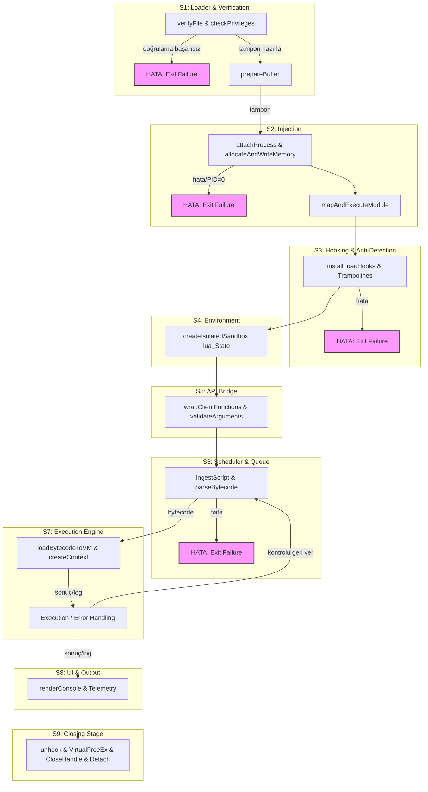

# Kravs Roblox Executor (`~/kravs`)

> **[+]Meezo Tsardom[-]**

Modular Roblox Executor implementation adhering to the 9-phase architecture pipeline (including S9 Closing Stage) and robust K-4 platform/VM dependency wiring.
*(Last updated for Commit 2 Mermaid schema synchronization)*

## Architecture & Data Flow (Mermaid Schema with 6 Mandatory Corrections)



## K-4 Platform & VM Dependencies
- **Windows API:** `OpenProcess`, `VirtualAllocEx`, `WriteProcessMemory`, `VirtualFreeEx`, `CloseHandle` (linked via CMake conditional target checks).
- **Luau VM:** Open-source Luau parser, bytecode compiler, and VM state (`lua_State*`).

## Build, Test & Run

```bash
mkdir build && cd build
cmake ..
make
ctest --output-on-failure
./kravs_executor
```
